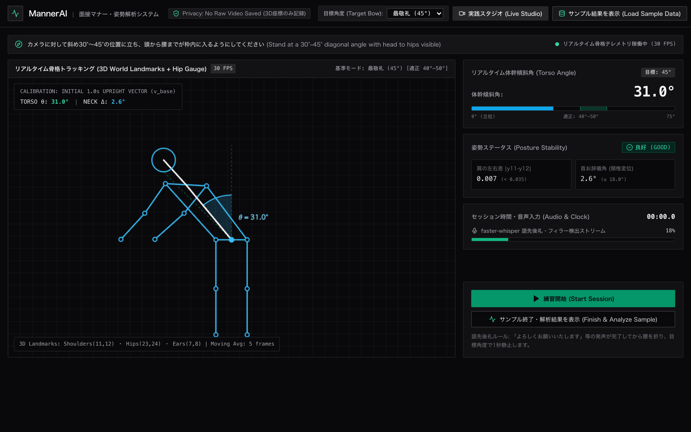
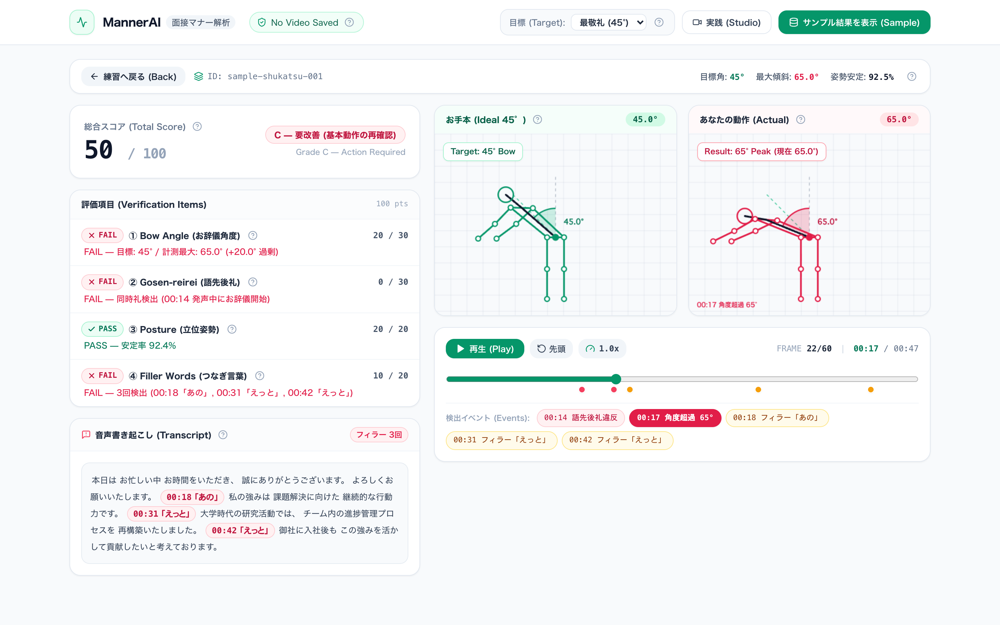
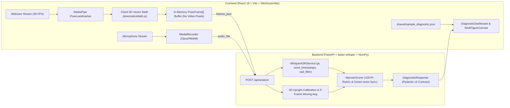

# MannerAI | 面接マナー・姿勢指導システム
**On-Device Multimodal Japanese Job-Hunting (Shukatsu) Interview Etiquette Verification Engine**

MannerAI is a privacy-preserving, multimodal biomechanical and acoustic verification system designed for Japanese job-hunting (*Shukatsu*) interview preparation. It synchronizes 30 FPS 3D skeletal pose estimation (`@mediapipe/tasks-vision` WebAssembly/WebGL) with word-level automatic speech recognition (`faster-whisper` INT8 CPU inference) to quantitatively evaluate four foundational Japanese business etiquette criteria: hip-hinged bow inclination angle, *Gosen-reirei* (voice-before-bow temporal separation), upright postural symmetry, and vocalized hesitation fillers.

---

## Visual Overview / 画面プレビュー

### 1. Live Practice Studio (`PracticeView.jsx` / 実践スタジオ)

*Real-time 30 FPS skeletal joint projection, hip-pivot inclination arc gauge, 1.0-second upright baseline vector calibration (`v_base`), lateral shoulder tilt telemetry, and microphone RMS monitoring.*

### 2. Post-Session Diagnostic Dashboard (`DiagnosticDashboard.jsx` / 解析ダッシュボード)

*12-column post-session diagnostic workspace: 5-column 100-point rubric scorecard and clickable filler-annotated transcript on the left; 7-column synchronized dual-canvas stick-figure comparison (`45° Ideal Reference` vs `65° Actual Recorded`) and event scrubber on the right.*

---

## System Architecture & Privacy Model ("No Video Saved")

Raw webcam video frames never leave the browser and are never written to disk. During an active session, the frontend extracts 33 3D `worldLandmarks` (in meters, origin at the hip center) and 2D normalized image coordinates per frame, immediately discarding the underlying pixel buffer.



---

## Biomechanical & Temporal Formulation

### 1. 3D Diagonal-Invariant Bow Angle (θ(t))

To prevent self-occlusion of the hip hinge and cervical spine, candidates stand at a 30°–45° diagonal yaw relative to the camera optical axis. Simple 2D screen-space projection fails under diagonal yaw, so inclination is formulated in 3D metric world space using MediaPipe `worldLandmarks`:

1. **Torso Vector Definition:**

$$\vec{v}_{\mathrm{torso}}(t) = \frac{P_{11}(t) + P_{12}(t)}{2} - \frac{P_{23}(t) + P_{24}(t)}{2}$$

where landmarks `(11, 12)` denote the left and right shoulders and `(23, 24)` denote the left and right hips.

2. **Upright Baseline Calibration (t ∈ [0, 1000 ms]):**

$$\vec{v}_{\mathrm{base}} = \frac{1}{N_{\mathrm{cal}}} \sum_{t \le 1.0\,\mathrm{s}} \vec{v}_{\mathrm{torso}}(t)$$

3. **3D Inclination Angle & Temporal Smoothing:**

$$\theta_{\mathrm{raw}}(t) = \arccos\left(\mathrm{clip}\left(\frac{\vec{v}_{\mathrm{torso}}(t) \cdot \vec{v}_{\mathrm{base}}}{\lVert \vec{v}_{\mathrm{torso}}(t) \rVert \, \lVert \vec{v}_{\mathrm{base}} \rVert}, -1.0, 1.0\right)\right) \times \frac{180}{\pi}$$

A 5-frame uniform moving average filter suppresses single-frame keypoint estimation jitter while preserving peak bow dynamics.

4. **Cervical Spine Alignment (*Kubi-ojigi* Detection):**

$$\vec{v}_{\mathrm{neck}}(t) = \frac{P_{7}(t) + P_{8}(t)}{2} - \frac{P_{11}(t) + P_{12}(t)}{2}$$

Angular deviation between `v_torso(t)` and `v_neck(t)` exceeding `18.0°` flags forward head flexion (*Kubi-ojigi*).

### 2. Target Bow Modes

| Bow Mode (日本語 / Romaji) | Target Angle | Passing Peak Window (`θ_max`) | Typical Interview Context |
| :--- | :---: | :---: | :--- |
| **会釈 (Eshaku)** | `15°` | `11.0° ≤ θ_max ≤ 20.0°` | Entering/passing in corridors, seated acknowledgment |
| **敬礼 (Keirei)** | `30°` | `25.0° ≤ θ_max ≤ 35.0°` | Standard room entry greeting (`よろしくお願いいたします`) |
| **最敬礼 (Saikeirei)** [Default] | `45°` | `40.0° ≤ θ_max ≤ 50.0°` | Deep gratitude at interview conclusion (`ありがとうございました`) |

### 3. Temporal Verification of *Gosen-reirei* (語先後礼)

Formal Japanese business etiquette mandates completing the verbal greeting prior to initiating hip flexion (*Gosen-reirei*), prohibiting simultaneous speaking and bowing (*Dojirei* / 同時礼). Given word intervals `[t_wordStart, t_wordEnd]` from `faster-whisper` and the bow interval `[t_bowStart, t_bowEnd]`:

$$t_{\mathrm{bowStart}} \ge t_{\mathrm{speechEnd}} - 150\,\mathrm{ms} \quad \text{and} \quad \forall t \in [t_{\mathrm{wordStart}}, \, t_{\mathrm{wordEnd}} - 150\,\mathrm{ms}], \; \theta(t) \le 15.0^\circ$$

Any violation zeroes the 30-point *Gosen-reirei* allocation and emits a timestamped timeline marker (`00:14 語先後礼違反`).

---

## 100-Point Scoring Rubric (`backend/scoring/manner_scorer.py`)

| Criterion | Max Score | Passing Condition & Deduction Formula |
| :--- | :---: | :--- |
| **1. Bow Angle (お辞儀角度)** | `30 pts` | Primary bow interval must sustain `θ(t) > 10°` for `≥ 0.4 s`. Full 30 pts if `θ_max` is within the mode window; `-1.5 pts` per degree of error outside the window (minimum 0). |
| **2. Gosen-reirei (語先後礼)** | `30 pts` | Full 30 pts if speech and bow (`> 15°`) are cleanly separated; 0 pts if simultaneous bow (*Dojirei*) is detected. |
| **3. Posture & Symmetry (立位姿勢)** | `20 pts` | Across upright frames (`θ(t) ≤ 10°`), checks lateral shoulder levelness (`|y_11 - y_12| < 0.035`) and cervical alignment (`≤ 18°`). Passes (20 pts) if `≥ 80%` of upright frames are stable. |
| **4. Filler Words (つなぎ言葉)** | `20 pts` | Detects `["あの", "あのー", "えっと", "えーと", "えー", "その", "なんか", "まあ"]`. 0 fillers = 20 pts (`PASS`); 1–2 fillers = 10 pts (`FAIL`); `≥ 3` fillers = 0 pts (`FAIL`). |

---

## Team Module Ownership & Data Contract (5-Engineer Decoupled Layout)

To prevent merge conflicts during parallel development, the codebase is partitioned into five isolated domain modules communicating strictly through `backend/schemas.py` and `shared/sample_diagnostic.json`:

| Engineer Role | Assigned Directory | Primary Files | Input / Output Contract | Independent Verification Command |
| :--- | :--- | :--- | :--- | :--- |
| **1. ASR & Disfluency Engineer** | `backend/asr/` | `whisper_engine.py` | Audio file → `(transcript_text, List[WordToken], List[FillerOccurrence])` | `pytest backend/tests/test_manner_engine.py -k filler` |
| **2. 3D Kinematics Engineer** | `backend/kinematics/` | `bow_evaluator.py` | `List[PoseFrame]` → `(BowIntervalSummary, PostureSummary, ideal_frames)` | `pytest backend/tests/test_manner_engine.py -k bow` |
| **3. Etiquette Scoring & API Engineer** | `backend/scoring/`, `backend/main.py` | `manner_scorer.py`, `schemas.py`, `main.py` | `PoseFrame[] + WordToken[]` → `DiagnosticResponse` JSON | `pytest backend/tests/test_manner_engine.py` |
| **4. Client Vision & Audio Engineer** | `frontend/src/modules/` | `usePoseTracker.js`, `kinematicsMath.js`, `useAudioRecorder.js`, `StickFigureCanvas.jsx` | Webcam/Mic streams → 30 FPS `PoseFrame` & dual-canvas projection | `npm --prefix frontend run build` |
| **5. Diagnostic UI & UX Engineer** | `frontend/src/components/` | `Navbar.jsx`, `PracticeView.jsx`, `DiagnosticDashboard.jsx`, `ScoreCard.jsx`, `TimelineBar.jsx` | Renders `shared/sample_diagnostic.json` via `Load Sample Data` without backend | `npm --prefix frontend run dev` (click `サンプル結果を表示`) |

---

## Local Setup & Execution Guide

### 1. Backend Setup (macOS / Linux / Windows)

**macOS / Linux:**
```bash
python3 -m venv .venv
source .venv/bin/activate
pip install -r backend/requirements.txt
PYTHONPATH=backend uvicorn main:app --reload --host 127.0.0.1 --port 8000
```

**Windows (PowerShell):**
```powershell
python -m venv .venv
.\.venv\Scripts\Activate.ps1
pip install -r backend\requirements.txt
$env:PYTHONPATH="backend"; uvicorn main:app --reload --host 127.0.0.1 --port 8000
```

Run backend verification tests:
```bash
PYTHONPATH=backend pytest backend/tests/
```

### 2. Frontend Setup (macOS / Linux / Windows)

```bash
cd frontend
npm install
npm run dev
```

Open `http://127.0.0.1:5173` in a Chromium-based browser.
- To inspect the **Post-Session Diagnostic Dashboard** immediately without a webcam or running backend, click **`サンプル結果を表示 (Sample)`** in the top navigation bar.

### 3. Automated High-DPI Screenshot Generation

With the frontend server running on `http://127.0.0.1:5173`:
```bash
node scripts/capture_screenshots.mjs
```
This script launches headless Chromium at `1440x900` (`deviceScaleFactor: 2`) and writes `docs/screenshots/live_practice_view.png` and `docs/screenshots/diagnostic_split_view.png`.
